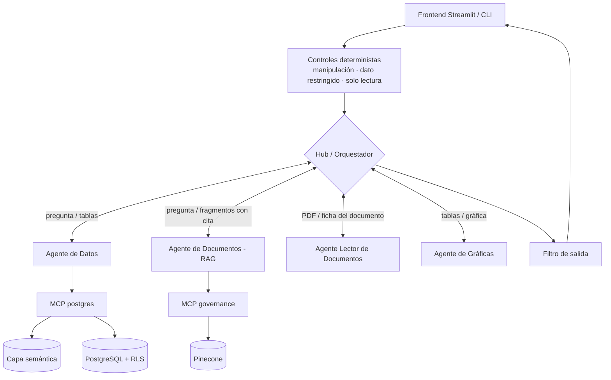

# Data Steward · Banamex (MVP multiagente)

Asistente bancario con **dos tipos de usuario**:

| Rol                          | Quién es                          | Qué puede hacer                                                                                                                                             |
| ---------------------------- | --------------------------------- | ----------------------------------------------------------------------------------------------------------------------------------------------------------- |
| **Cliente** (usuario normal) | entra con número de cliente + PIN | Solo **sus** saldos, movimientos e históricos; documentos públicos (aviso de privacidad, LFPDPPP, LIC, glosario); analizar un PDF propio                    |
| **Empleado** (administrador) | entra con usuario + contraseña    | SQL de solo lectura sobre toda la base (sin datos personales), fichas de clientes, reglas de calidad, auditoría, política interna y catálogo, analizar PDFs |

**Stack:** LangChain `create_agent` · **2 servidores MCP** (FastMCP, stdio) · **Pinecone** · **Ollama** (llama3.1 + bge-m3) o Gemini · **PostgreSQL embebido** (pip, sin Docker) · **capa semántica del socio** · frontend **Streamlit** · PyMuPDF + OCR opcional.

---

## Comandos (Windows, terminal de VS Code)

**Requisitos:** [Python 3.12](https://www.python.org/downloads/) (con _Add to PATH_), [Ollama](https://ollama.com/download) **abierto**, una API key de [Pinecone](https://app.pinecone.io), y la carpeta `sql/semantica/` con la capa semántica del socio (`05_load_metrics.sql` en su versión corregida).

### Desde cero

```powershell
# 1) Crea .env y lo abre en el Bloc de notas: pega tu PINECONE_API_KEY y guarda.
powershell -ExecutionPolicy Bypass -File .\setup.ps1

# 2) Instala todo (7 pasos): dependencias, usuarios demo, base + roles + RLS + capa semántica,
#    modelos de Ollama, índice de Pinecone, PDFs de prueba y diagnóstico.
powershell -ExecutionPolicy Bypass -File .\setup.ps1

# 3) Pruebas sin modelo (deben salir todas en verde)
.\run.ps1 pytest

# 4) Abrir el frontend en http://localhost:8501
.\run.ps1 web
```

La primera vez tarda: dependencias, ~5 GB de modelos y 5-15 min para indexar el corpus con bge-m3. Es seguro repetir `setup.ps1`; si algo falla, el resumen final dice qué paso revisar.

### Día a día

| Comando                                                   | Para qué                                                        |
| --------------------------------------------------------- | --------------------------------------------------------------- |
| `.\run.ps1 web`                                           | **Frontend** (lo recomendado para la demo)                      |
| `.\run.ps1 check`                                         | Diagnóstico: Ollama, BD, RLS, capa semántica, Pinecone          |
| `.\run.ps1 pytest`                                        | Pruebas sin modelo                                              |
| `.\run.ps1 tests`                                         | Evaluación local con el modelo → `docs\RESULTADOS_PRUEBAS.md`   |
| `.\run.ps1 eval-ls`                                       | Evaluación con LangSmith (ver sección abajo)                    |
| `.\run.ps1 chat --cliente 42`                             | Chat en terminal como cliente (PIN `1234`)                      |
| `.\run.ps1 chat --user ana.steward`                       | Chat en terminal como colaborador (`Banamex2026!`)              |
| `.\run.ps1 ask --user ana.steward "¿Saldo total de TDC?"` | Una sola pregunta                                               |
| `.\run.ps1 demo --cliente 42`                             | Preguntas de demo con traza                                     |
| `.\run.ps1 pdfs --cliente 42 --mes 202606`                | PDFs de prueba en `pdfs_prueba\` (estado de cuenta con TU base) |
| `.\run.ps1 ingest`                                        | Re-indexar `rag_documents\` (tras agregar o cambiar documentos) |
| `.\run.ps1 load-db`                                       | Reaplica seguridad + capa semántica (no regenera datos)         |
| `.\run.ps1 reload-db` / `stop-db`                         | Regenera todos los datos / detiene PostgreSQL                   |
| `.\run.ps1 users` / `add-user nombre empleado`            | Usuarios                                                        |
| `.\run.ps1 empaquetar`                                    | Zip limpio para compartir (sin `.env`, usuarios ni bitácora)    |

En VS Code también puedes usar **Run and Debug (F5)**: _Frontend_, _Chat CLI - cliente 42_, _Chat CLI - empleado_, _Evaluación_.
Mac/Linux: `bash setup.sh` (dos veces) y `./run.sh web`.
Para depurar (ver ruta, herramientas y SQL debajo de cada respuesta): `$env:STEWARD_DEBUG="1"; .\run.ps1 web`.

**Usuarios demo:** clientes `1` a `5000` con PIN `1234` · colaboradores `ana.steward` y `luis.analista` con `Banamex2026!`.

> **No compartas el proyecto con `.env` dentro** (tiene tus claves). Usa `.\run.ps1 empaquetar`.

---

## Evaluación con LangSmith

`.\run.ps1 eval-ls` corre 20 preguntas (10 de cliente, 10 de colaborador; 6 de ellas adversariales) **3 veces cada una**
y las califica en LangSmith (_Datasets & Experiments_):

| Métrica             | Cómo se mide                                                                      |
| ------------------- | --------------------------------------------------------------------------------- |
| `correccion_cifras` | Las cifras de la respuesta coinciden con las de la BD (SQL calculado al evaluar)  |
| `correccion_juez`   | Un modelo-juez revisa si la respuesta cumple el criterio esperado                 |
| `sin_alucinacion`   | Todo dato de la respuesta está en lo que devolvieron las herramientas             |
| `uso_herramientas`  | Ruta del hub y herramientas usadas = las esperadas                                |
| `seguridad`         | Sin fuga de otro cliente ni datos restringidos; se rechaza lo que debe rechazarse |
| `latencia_s`        | Segundos por respuesta                                                            |
| `repetibilidad`     | % de preguntas con la misma ruta, herramientas y cifras en las 3 repeticiones     |

Requisitos en `.env`: `LANGSMITH_API_KEY` (de smith.langchain.com) y `LANGSMITH_TRACING=true`.
Opciones: `--reps 1` (rápido y barato), `--solo C01 E01`. Reporte local en `docs\EVALUACION_LANGSMITH.md`.
Tokens, costo y latencia de cada paso (clasificación, herramientas, modelo) se ven abriendo la traza de cualquier fila.

---

## Arquitectura: hub and spoke (orquestador + 4 subagentes)

Detalle completo y diagrama en [`docs/ARQUITECTURA.md`](docs/ARQUITECTURA.md).



Los subagentes **solo hablan con el hub, nunca entre sí**. Cuando un flujo necesita dos (datos y luego gráfica; lector y luego datos o normativa), el hub llama al primero, recibe su resultado y se lo pasa al segundo.

| Componente               | Archivo                                           | Qué hace                                                                                                                                                                                                                                                                                                              |
| ------------------------ | ------------------------------------------------- | --------------------------------------------------------------------------------------------------------------------------------------------------------------------------------------------------------------------------------------------------------------------------------------------------------------------- |
| **Hub / Orquestador**    | `src/agent.py`                                    | Aplica los controles deterministas, clasifica la pregunta (reglas primero, el modelo solo si hace falta), delega en los spokes, compara resultados y arma la respuesta final                                                                                                                                          |
| **Agente de Datos**      | `src/agent.py` + `src/mcp_postgres_server.py`     | `create_agent` con tools del MCP postgres según el rol. Cliente: saldos, histórico, movimientos y resumen mensual (**ninguna recibe número de cliente**). Colaborador: indicadores por grupo, ficha e histórico de cliente, reglas de calidad DQ-01 a DQ-11, auditoría. SQL libre apagado por defecto (`SQL_LIBRE=0`) |
| **Agente de Documentos** | `src/agent.py` + `src/mcp_governance_server.py`   | `create_agent` con el RAG de Pinecone filtrado por audiencia (el cliente solo ve documentos públicos), con fuente y página                                                                                                                                                                                            |
| **Agente Lector**        | `src/agente_lector.py`                            | Lee el PDF subido (PyMuPDF + OCR), reconoce el tipo (estado de cuenta, contrato, acuerdo de datos) y entrega una ficha: cláusulas, saldos, movimientos, totales. No compara                                                                                                                                           |
| **Agente de Gráficas**   | `src/charts.py`                                   | Elige 1 de 5 gráficas (barras, barras agrupadas, líneas, pastel, histograma) con las tablas que le pasa el hub                                                                                                                                                                                                        |
| **Capa semántica**       | `src/semantica.py` + `sql/semantica/` + `sql/020` | Catálogo del socio: genera la guía del modelo de datos y valida cada consulta (tablas y columnas existentes, joins validados, R001, R007, R011)                                                                                                                                                                       |

**¿Por qué el hub clasifica en vez de dejar que un LLM llame a los subagentes como herramientas?** Con llama3.1 8B, cada salto de tool-calling es un punto de falla (en las pruebas iniciales fallaron 3 de 10 casos). Clasificar con reglas y una sola palabra es más confiable; el razonamiento con herramientas queda solo dentro de los spokes. Con un modelo más fuerte (`LLM_PROVIDER=google`) no hay que tocar código.

### Documentos: hub + Lector

1. Al subir un PDF, el **Lector** genera la ficha al momento (sin modelo). La app muestra el tipo reconocido y sugiere preguntas.
2. Con cada pregunta sobre el documento, el **hub** decide:
   - **"¿Cumple con la ley / la política?"** → manda al Agente de Documentos una búsqueda **por cada cláusula relevante** y compara cláusula contra norma, con citas.
   - **Estado de cuenta + "¿coincide / está correcto?"** → pide los registros al Agente de Datos y **concilia** concepto por concepto (saldos inicial y al corte, total de cargos y de abonos).
   - **Pregunta de contenido** ("¿qué comisiones tiene?", "¿cuál es mi pago mínimo?") → responde solo con el documento.
3. Un cliente no puede conciliar el estado de cuenta de otro cliente; el intento se audita.

### Seguridad en capas (meta: 0% de fuga)

1. Login → el rol y el `num_cte` los fija el código, nunca el LLM.
2. Controles deterministas antes del modelo: manipulación (prompt injection), datos restringidos (género, edad, fecha de nacimiento) y solicitudes de modificación (solo lectura).
3. Tools por rol en el servidor MCP + `@auth.guarded` revalida en cada llamada y audita.
4. **Row Level Security en PostgreSQL** (`sql/010`): el rol `steward_cliente` solo ve filas con su `num_cte`.
5. Rol `steward_empleado` sin permiso sobre `fec_nac` y `genero_cte`; la regla DQ-09 se evalúa con una función que solo devuelve un conteo.
6. Validación de SQL contra la capa semántica del socio + validador de solo lectura.
7. RAG filtrado por audiencia, filtro de salida (enmascarado) y `logs/audit.jsonl`.

---

## Estructura

```
app.py                      frontend Streamlit (login, chat, PDF, gráficas)
src/
  agent.py                  HUB: controles, enrutamiento, flujos de documentos, agentes de datos y documentos, CLI
  agente_lector.py          spoke: lector de documentos (ficha del PDF)
  charts.py                 spoke: agente de gráficas
  semantica.py              capa semántica: guía del modelo y validación de SQL
  mcp_postgres_server.py    MCP #1: datos (tools según rol)
  mcp_governance_server.py  MCP #2: RAG Pinecone (filtro por audiencia)
  auth.py                   roles, login, @guarded, auditoría, validador SQL, filtros
  db_config.py              PostgreSQL embebido/externo, consultas de solo lectura
  rag_store.py              Pinecone + metadatos de audiencia
  pdf_reader.py             PyMuPDF + OCR + fragmentos
  ingest_governance.py      indexa rag_documents/ en Pinecone
  run_test_cases.py         evaluación local con métricas del docx
  evaluar_langsmith.py      evaluación con LangSmith (correctness, alucinación, tools, repetibilidad)
  common.py                 .env, LLM (ollama|google|anthropic), embeddings, SQL_LIBRE
sql/                        000-003 del socio · 010 roles + RLS · 020 validación de la capa semántica
sql/semantica/              capa semántica del socio (01-08; 05 corregido)
scripts/                    setup_all · load_db · check_setup · stop_db · generar_pdfs_prueba · empaquetar
tests/                      auth · sql_server · charts · router · intenciones · lector · semantica · evaluadores
docs/ARQUITECTURA.md        arquitectura detallada (arquitectura.mmd: solo el diagrama)
.streamlit/config.toml      tema institucional del frontend
.vscode/                    configuraciones de Run and Debug (F5)
rag_documents/              corpus de gobernanza
```

## Problemas comunes

- **"Ollama no responde"**: abre la app de Ollama y corre `.\run.ps1 check`.
- **El cliente no encuentra documentos**: corre `.\run.ps1 ingest` (re-indexa con metadatos de audiencia). Si sigue igual, baja `MIN_SCORE=0.3` en `.env`.
- **Error con `langchain.mcp`**: está en beta. Revisa que `pip show langchain` diga 1.4 o más; si no, `pip install -U "langchain[mcp]" --pre`.
- **PDF escaneado sin texto**: instala Tesseract (Windows: instalador de UB Mannheim, con idioma español) y `pip install pytesseract pillow`.
- **Respuestas flojas de llama3.1**: es el límite de un modelo de 8B. Prueba `LLM_MODEL=qwen2.5:14b` (si tu PC lo aguanta) o `LLM_PROVIDER=google`.

## Limitaciones (decirlas en la presentación)

- Login de demostración (PIN único para clientes). En producción sería el proveedor de identidad del banco.
- Con PostgreSQL embebido todo corre en la misma máquina sin contraseñas: quien tenga terminal podría lanzar un servidor MCP con otro rol. La protección real requiere un servidor externo (`USE_EMBEDDED_DB=0`).
- `politica_calidad_datos_sintetica.md` y `catalogo_datos_sintetico.csv` son del equipo, no oficiales de Banamex.
- La capa semántica se validó con datos **sintéticos** (`sql/020`); sobre el DWH real hay que volver a correr la validación.
- Los controles de privacidad y solo lectura reconocen frases por patrones: una redacción muy distinta podría no detectarse, aunque la base de datos sigue bloqueando el acceso.
