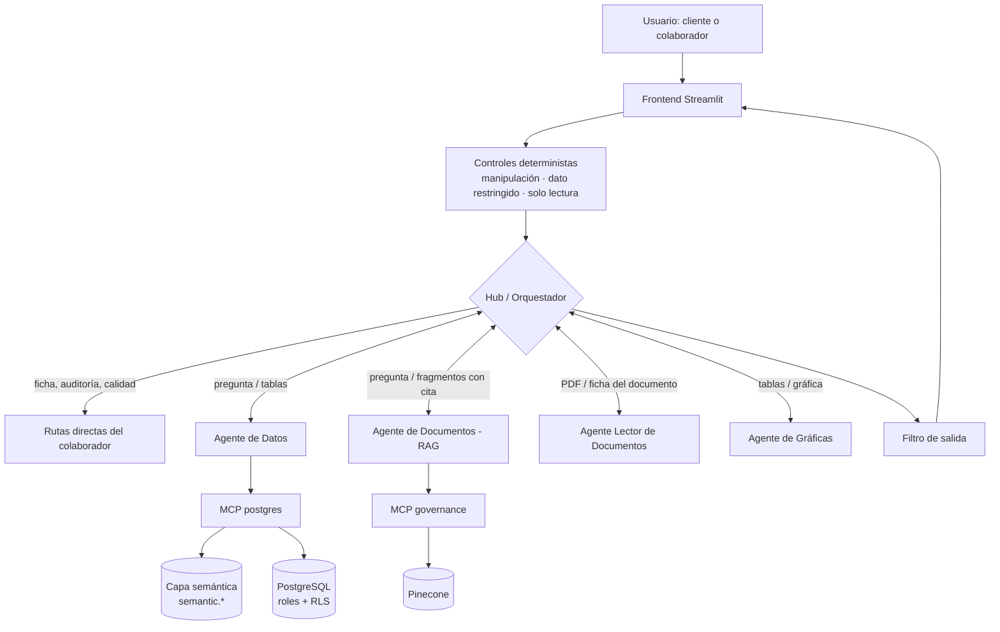

# Arquitectura del Data Steward

Hub (orquestador) con **4 subagentes**, **2 servidores MCP** y la **capa semántica del socio** como fuente de verdad del modelo de datos.

Patrón **hub and spoke estricto**: los 4 subagentes solo hablan con el hub y nunca entre sí. Si un flujo necesita
a dos subagentes (datos y luego gráfica; lector y luego datos o normativa), el hub llama al primero, recibe su
resultado y se lo pasa al segundo.

## Subagentes

| Subagente                                  | Qué hace                                                                                                                                                             | Cómo                                                                               |
| ------------------------------------------ | -------------------------------------------------------------------------------------------------------------------------------------------------------------------- | ---------------------------------------------------------------------------------- |
| **Hub / Orquestador**                      | Clasifica la pregunta, decide a quién delegar y contra qué comparar, y arma la respuesta final                                                                       | Reglas deterministas primero; el modelo solo clasifica lo que no cubren las reglas |
| **Agente Lector** (`src/agente_lector.py`) | Lee el PDF (PyMuPDF + OCR), reconoce el tipo (estado de cuenta, contrato, acuerdo de datos) y extrae una ficha: cláusulas, saldos, movimientos, totales, pago mínimo | Extracción determinista; **no compara**, solo entrega la ficha al hub              |
| **Agente de Datos**                        | Consulta PostgreSQL vía MCP con herramientas por rol                                                                                                                 | Indicadores parametrizados; SQL libre apagado por defecto                          |
| **Agente de Documentos**                   | Busca en la normativa y en las políticas (Pinecone) con filtro por audiencia                                                                                         | RAG con citas de fuente y página                                                   |
| **Agente de Gráficas**                     | Elige 1 de 5 tipos de gráfica con las tablas del Agente de Datos                                                                                                     | El modelo elige y las reglas corrigen                                              |

## Flujo de documentos (hub + lector)

1. El usuario sube un PDF y el **lector** genera la ficha al momento (sin modelo).
2. Ante una pregunta sobre el documento, el **hub** decide:
   - **¿Cumple / qué dice la ley o la política?** → busca en el RAG una consulta **por cada cláusula relevante** y compara cláusula contra norma.
   - **Estado de cuenta + "¿coincide / está correcto?"** → pide los registros al **Agente de Datos** y **concilia** concepto por concepto (saldo inicial, saldo al corte, total de cargos, total de abonos). La comparación es determinista.
   - **Pregunta de contenido** ("¿qué comisiones tiene?", "¿cuál es mi pago mínimo?") → responde solo con el documento.
3. Seguridad: un cliente **no puede conciliar el estado de cuenta de otro cliente**; el intento queda en la auditoría.

## Capa semántica del socio

- `sql/semantica/01-07`: scripts del socio. Se corrigió `05_load_metrics.sql`: M004 y M005 tenían un valor de más y hacían fallar ese script y, en cascada, el 06.
- `sql/020_validacion_capa_semantica.sql`: valida contra los datos los **7 pendientes** del README del socio. Deja la evidencia en `semantic.sem_validaciones` (15 validaciones) y marca como **validadas solo las relaciones que pasan**:
  - Validadas: cliente↔saldos, cliente↔transacciones, producto↔saldos, producto↔transacciones y la nueva **tipo_transaccion_compuesta** (`cve_producto + cve_txn`).
  - Bloqueada: `tipo_transaccion` por `cve_txn` sola (V03: hay 4 claves repetidas).
  - Reglas nuevas derivadas de la evidencia: **R010** (clasificar movimientos por `desc_txn`) y **R011** (agrupar por producto, no por `dominio`).
- En ejecución (`src/semantica.py`):
  - La **guía del modelo de datos** se genera desde el catálogo: tablas, columnas, métricas M001-M005, reglas R001-R011 y joins validados.
  - Cada consulta SQL se valida contra el catálogo: tablas y columnas existentes, columnas restringidas, **R001** (no sumar saldos de varios meses), **R005** (solo joins validados), **R007** (preagregar antes de unir hechos) y **R011**.
  - **SQL libre apagado por defecto** (`SQL_LIBRE=0`), como pide el socio ("el LLM no debe ejecutar SQL directamente"). Se enciende con `SQL_LIBRE=1` solo para desarrollo.

> La evidencia de validación proviene de datos **sintéticos**. Sobre el DWH real, `020` debe volver a correrse; las relaciones solo quedan validadas si pasan ahí.
